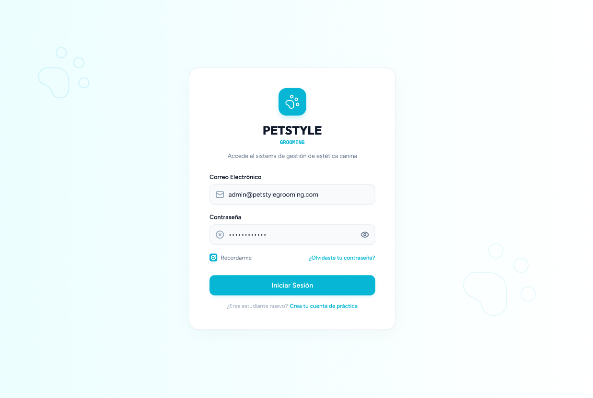
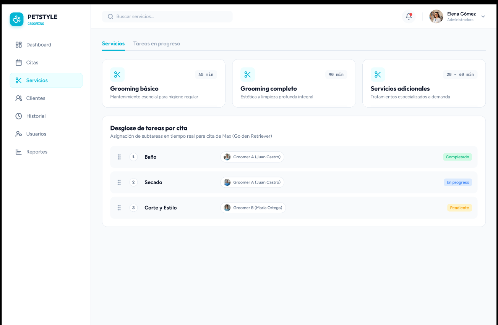
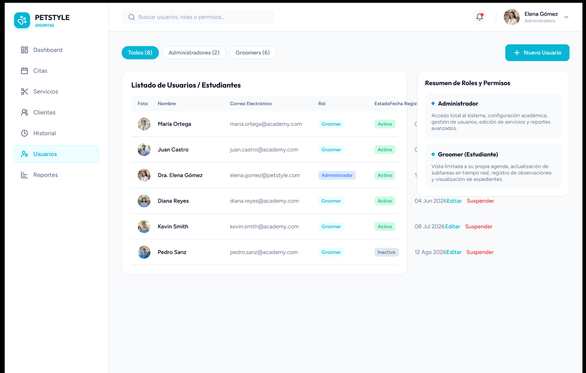
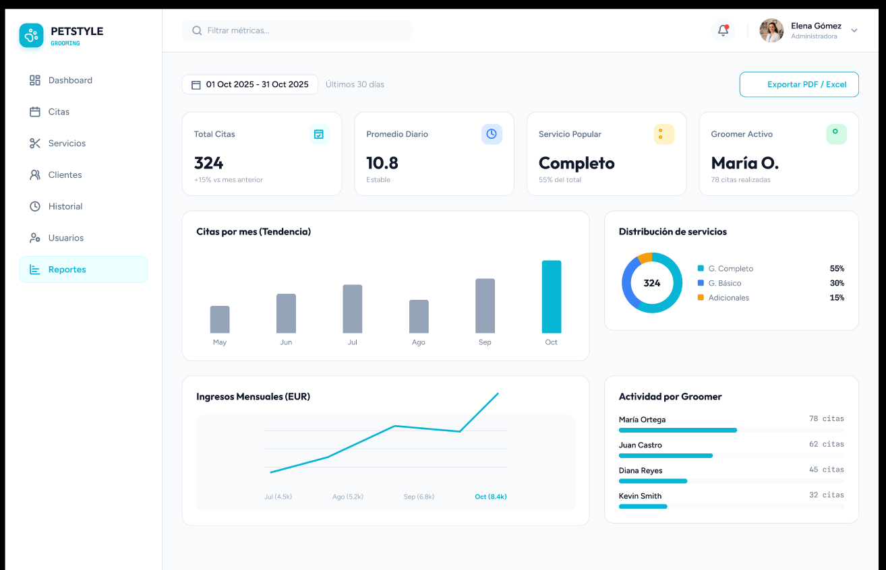
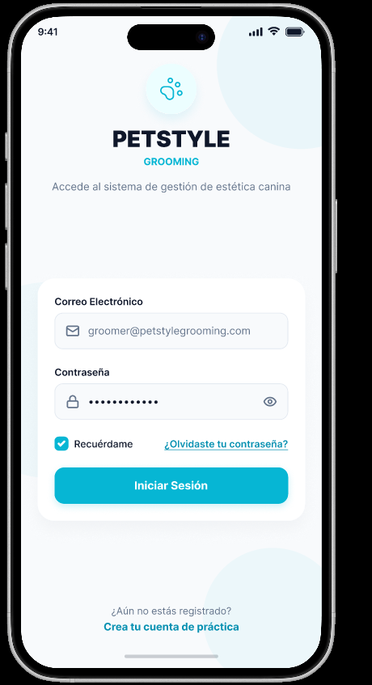
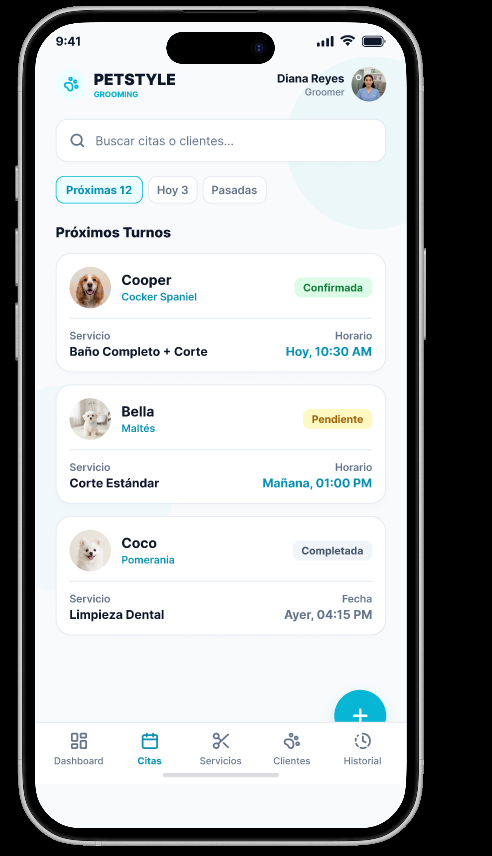
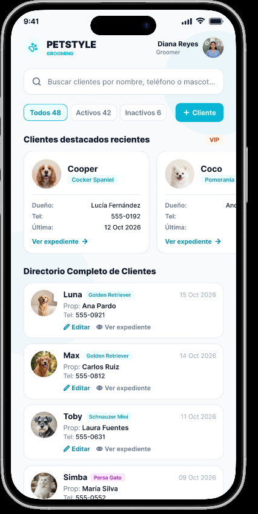

# Sistema Multiplataforma de Gestión de Grooming Canino

## Integrantes

- Manuel Alejandro Mejia López - ML251320
- Lily Astrid Pérez Avelar - PA251527
- Ariel Omar Nunfio Méndez - NM253359
- Levi Asael Valle Palma - VP253612
- Wilber Larris Carranza Campos - CC253652

Plataforma multiplataforma para la gestión operativa de un negocio de grooming canino. La solución centraliza clientes, perros, citas, servicios, tareas, disponibilidad de Groomers, historial de atención y métricas operativas mediante una plataforma web y una aplicación móvil.

Proyecto desarrollado para la asignatura **DPS941 — Diseño y Programación de Software Multiplataforma**.

---

# Objetivo

Reducir la dependencia de WhatsApp, llamadas y agenda física para la coordinación de las atenciones de grooming.

El sistema permite:

- Registrar clientes y mascotas.
- Gestionar servicios.
- Programar citas.
- Asignar tareas a Groomers.
- Consultar disponibilidad.
- Dar seguimiento al estado de las atenciones.
- Registrar información del servicio realizado.
- Consultar historial.
- Visualizar métricas operativas.

La solución contempla:

- Una **plataforma web** orientada principalmente a la administración.
- Una **aplicación móvil** orientada principalmente a los Groomers y al seguimiento operativo.

---

# Estado funcional

La solución integra los módulos principales requeridos para la gestión del negocio:

- Autenticación y control de roles.
- Gestión de usuarios.
- Gestión de clientes.
- Gestión de perros.
- Gestión de servicios.
- Gestión de citas.
- Asignación y seguimiento de tareas.
- Disponibilidad y horarios de Groomers.
- Historial y Registro de Atención.
- Dashboard administrativo.
- Dashboard de Groomer.
- Aplicación móvil integrada con Firebase.

La ruta `/` de la aplicación web redirige a `/login`.

---

# Roles

## Administrador

El Administrador puede gestionar:

- Usuarios.
- Clientes.
- Perros.
- Servicios.
- Citas.
- Groomers.
- Horarios.
- Asignaciones.
- Historial.
- Dashboard y métricas operativas.

## Groomer

El Groomer accede a las funciones relacionadas con la atención y seguimiento operativo.

Puede:

- Consultar sus citas.
- Consultar tareas asignadas.
- Actualizar el estado de sus tareas.
- Consultar clientes y mascotas.
- Registrar información de una atención.
- Consultar historial.

---

# Funcionalidades principales

- Registro e inicio de sesión.
- Autenticación mediante correo electrónico y contraseña.
- Autenticación mediante Google.
- Control de acceso según rol.
- Gestión de usuarios.
- Gestión de clientes.
- Gestión de perros.
- Gestión del catálogo de servicios.
- Creación y administración de citas.
- Asignación de tareas a Groomers.
- Consulta de disponibilidad.
- Seguimiento del estado de las tareas.
- Registro de atenciones.
- Consulta del historial.
- Dashboard administrativo.
- Persistencia mediante Firebase.

La relación principal de la información sigue el flujo:

```text
Cliente
   ↓
Perro
   ↓
Cita
   ↓
Servicios / Tareas
   ↓
Groomer
   ↓
Historial de atención
```

---

# Dashboard administrativo

El Dashboard presenta un resumen de la operación del negocio utilizando la información registrada en el sistema.

Incluye información relacionada con:

- Citas del día.
- Citas de la semana.
- Citas del mes.
- Citas programadas.
- Citas en proceso.
- Citas completadas.
- Citas canceladas.
- Tareas activas.
- Servicios solicitados.
- Clientes.
- Perros.
- Próximas citas.
- Actividad reciente.

---

# Historial / Registro de Atención

El módulo de historial permite conservar información relacionada con las atenciones realizadas a las mascotas.

Durante una atención se puede registrar información sobre:

- Ojos.
- Oídos.
- Dientes.
- Pelaje.
- Comportamiento.
- Uñas.
- Puntualidad.
- Observaciones.

La información registrada queda disponible posteriormente para su consulta dentro del historial.

---

# Aplicación móvil

La versión móvil fue desarrollada con **React Native y Expo** y está orientada principalmente al trabajo operativo de los Groomers.

## Módulos móviles

### Autenticación y Roles

Permite iniciar sesión y controlar las funcionalidades disponibles según el usuario autenticado.

### Inicio / Dashboard

Presenta información general relacionada con las actividades del Groomer.

### Citas

Permite consultar citas asignadas y visualizar su información correspondiente.

### Tareas

Permite visualizar las tareas relacionadas con las citas y actualizar su estado.

### Clientes y Perros

Permite consultar y gestionar información relacionada con clientes y mascotas.

Incluye:

- Registro de clientes.
- Edición de clientes.
- Registro de perros.
- Edición de perros.
- Consulta de la relación Cliente → Perro.

### Historial

Permite registrar y consultar información relacionada con las atenciones realizadas.

---

# Tecnologías utilizadas

## Plataforma Web

- JavaScript.
- React.
- Next.js 16.3.4.
- App Router.
- Tailwind CSS.
- Context API.
- Route Handlers de Next.js.
- Firebase.
- Firebase Admin SDK.
- Vercel.

## Plataforma Móvil

- React Native.
- Expo.
- JavaScript.
- Context API.
- Firebase SDK.

## Servicios e infraestructura

- Firebase Authentication.
- Autenticación mediante Google.
- Cloud Firestore.
- Firebase Admin SDK.
- Vercel.

---

# Arquitectura

## Arquitectura Web

```text
Interfaz
   ↓
Hooks / Context
   ↓
Repositories / Services
   ↓
API interna de Next.js
   ↓
Route Handlers
   ↓
Validación y autorización
   ↓
Firebase
   ↓
Cloud Firestore
```

La aplicación web utiliza Route Handlers de Next.js para ejecutar lógica del servidor, validaciones, autorización y comunicación con los servicios de Firebase.

## Arquitectura Móvil

```text
Interfaz React Native
   ↓
Context / Services
   ↓
Firebase SDK
   ↓
Firebase Authentication
   ↓
Cloud Firestore
```

La aplicación móvil utiliza Firebase para autenticación y persistencia de información.

---

# Estructura del proyecto

```text
grooming-canino/
│
├── docs/
│   └── mockups/
│
├── mobile/
│
├── public/
│
├── scripts/
│
├── src/
│   ├── app/
│   │   ├── admin/
│   │   ├── groomer/
│   │   └── api/
│   ├── components/
│   ├── config/
│   ├── context/
│   ├── hooks/
│   ├── repositories/
│   ├── server/
│   ├── services/
│   └── utils/
│
├── firebase.json
├── firestore.rules
├── package.json
└── README.md
```

---

# Persistencia

La solución final utiliza **Cloud Firestore** para almacenar la información principal del sistema.

Entre los tipos de información gestionados se encuentran:

```text
usuarios
servicios
tareas
citas
horarios
clientes
perros
historial
```

La integración con Firebase permite que los módulos web y móvil trabajen con información almacenada dentro del proyecto Firebase de Grooming Canino.

---

# Autenticación

La solución incorpora autenticación mediante:

- Correo electrónico y contraseña.
- Google.

Firebase Authentication se utiliza como servicio de autenticación.

El sistema utiliza la información del usuario autenticado y su rol para determinar las vistas y funcionalidades disponibles.

---

# Requisitos previos

Para ejecutar la aplicación web:

- Node.js compatible con Next.js 16.
- npm.

Para ejecutar la aplicación móvil:

- Node.js.
- npm.
- Expo.

---

# Instalación y ejecución local de la aplicación web

Desde la carpeta raíz del proyecto:

```bash
npm install
npm run dev
```

La aplicación web queda disponible localmente en:

```text
http://localhost:3000
```

> Este enlace corresponde únicamente al entorno local de desarrollo. La versión pública del proyecto se encuentra desplegada en Vercel.

## Comandos disponibles

```bash
npm install      # Instala las dependencias
npm run dev      # Ejecuta el entorno de desarrollo
npm run lint     # Ejecuta el análisis estático
npm run build    # Genera la compilación de producción
```

---

# Instalación y ejecución de la aplicación móvil

Desde la carpeta raíz del proyecto:

```bash
cd mobile
npm install
npx expo start
```

La aplicación puede ejecutarse mediante Expo Go o mediante un entorno compatible con Expo.

---

# Rutas principales de la aplicación web

## Públicas

```text
/login
/registro
```

## Administrador

```text
/admin/dashboard
/admin/usuarios
/admin/servicios
/admin/citas
/admin/groomers
/admin/clientes
/admin/perros
/admin/historial
```

## Groomer

```text
/groomer/dashboard
/groomer/servicios
```

---

# Entregables de la Etapa 3 – Avance 1

Los siguientes recursos corresponden al primer avance de la Etapa 3.

- **Código fuente:** [Aplicación React Native](./mobile/)
- **Video demostrativo:** [Ver video en SharePoint](https://udbedu-my.sharepoint.com/:v:/g/personal/pa251527_alumno_udb_edu_sv/IQBAAd2ySAyhT6Bdt7TC8iEiAZmwJVWNnYC8wLna_0-7TUo?e=MRR7xf)
- **Documento PDF:** [DPS Etapa 3 Implementacion Movil.pdf](https://github.com/user-attachments/files/33776560/DPS.Etapa.3.Implementacion.Movil.pdf)

---

# Entregables de la Etapa 3 – Avance 2

Los siguientes recursos corresponden al segundo avance de la Etapa 3.

- **Código fuente:** [Aplicación React Native](./mobile/)
- **Video demostrativo:** [Ver video](https://udbedu-my.sharepoint.com/:v:/g/personal/cc253652_alumno_udb_edu_sv/IQCHwS4BC4jyTpe2jbBpZpYtARMkS4aV7DKV7rRCYjLZmBI)
- **Documento PDF:** [Avance 2: Integración Firebase Authentication y Firestore](https://github.com/user-attachments/files/34580670/Avance.2.Integracion.Firebase.Authentication.y.Firestore.pdf)

---

# Etapa 3: Entrega Final

La entrega final corresponde a la integración completa de la solución multiplataforma de **Grooming Canino**, incorporando la versión web desarrollada con React y Next.js, la aplicación móvil desarrollada con React Native y la integración de Firebase.

## Video de defensa final

El video incluye la presentación general del proyecto, la explicación técnica del código de las plataformas web y móvil, y la demostración funcional del sistema.

[Ver video de defensa final en SharePoint](https://udbedu-my.sharepoint.com/:v:/g/personal/pa251527_alumno_udb_edu_sv/IQCN2v8fuUeeS4lmHDWPjmE7Acss2Pm63eV-FZbJUNm7vq8?e=GDWhfo)

## Versión web

La plataforma web fue desarrollada con **React + Next.js** y se encuentra desplegada públicamente mediante Vercel.

[Ver Grooming Canino en Vercel](https://grooming-canino.vercel.app)

La plataforma web incluye módulos de:

- Autenticación.
- Usuarios.
- Clientes.
- Perros.
- Servicios.
- Citas.
- Groomers.
- Historial.
- Dashboard administrativo.

## Versión móvil

La aplicación móvil fue desarrollada con **React Native + Expo** y utiliza Firebase para autenticación y gestión de información.

[Ver código fuente de la aplicación móvil](./mobile/)

Incluye módulos de:

- Autenticación.
- Inicio / Dashboard.
- Citas.
- Tareas.
- Clientes.
- Perros.
- Historial.

## Firebase

La solución utiliza el proyecto Firebase **grooming-canino-udb** para servicios de autenticación y persistencia.

Servicios utilizados:

- Firebase Authentication.
- Autenticación mediante Google.
- Cloud Firestore.
- Firebase Admin SDK en la plataforma web.

La aplicación web y la aplicación móvil utilizan Firebase para autenticación y persistencia de la información.

---

## Prototipo completo en Figma

El diseño completo desarrollado durante la **Etapa 1** puede consultarse en el siguiente enlace.

Los mockups fueron utilizados como referencia visual para el desarrollo del sistema. La implementación final conserva la línea general de diseño, aunque presenta ajustes en distribución, navegación, componentes y funcionalidades derivados de la integración y evolución del proyecto.

[Ver diseño completo en Figma](https://www.figma.com/design/MFM54o5ls92mNKkt0ylRB2/Visual-Mockup-for-PetStyle-Grooming--copia-?node-id=0-1)

---

# Enlaces de la Entrega Final

- **Repositorio GitHub:** https://github.com/lily-perez/grooming-canino
- **Aplicación web en Vercel:** https://grooming-canino.vercel.app
- **Aplicación móvil:** [Código fuente React Native](./mobile/)
- **Mockups:** [Ver carpeta de mockups](./docs/mockups/)
- **Prototipo Figma:** https://www.figma.com/design/MFM54o5ls92mNKkt0ylRB2/Visual-Mockup-for-PetStyle-Grooming--copia-?node-id=0-1
- **Licencia Creative Commons:** [Consultar licencia](./LICENCESE)

---

# Licencia

Este proyecto se distribuye bajo la licencia **Creative Commons Atribución 4.0 Internacional — CC BY 4.0**.

[Consultar archivo de licencia](./LICENCESE)

El proyecto puede utilizarse, compartirse y adaptarse siempre que se otorgue el crédito correspondiente a sus autores.

---

# Mockups de Figma

Los siguientes mockups corresponden a la propuesta visual desarrollada durante la **Etapa 1** y fueron utilizados como referencia para el desarrollo de la solución final.

Durante la implementación se realizaron ajustes de distribución, navegación y componentes para adaptarlos a los requerimientos funcionales finales de las versiones web y móvil.

## Mockups Web

### Inicio de sesión



### Servicios y tareas



### Gestión de usuarios



### Reportes



## Mockups Móvil

### Inicio de sesión



### Gestión de citas



### Gestión de clientes



---

# Cumplimiento de requerimientos de la Entrega Final

La solución desarrollada contempla los requerimientos establecidos para el proyecto final:

1. **Versión web:** desarrollada con React + Next.js y desplegada en Vercel.
2. **Versión móvil:** desarrollada con React Native y Firebase integrado.
3. **Autenticación:** implementación de inicio de sesión mediante correo electrónico y Google.
4. **Módulos principales y secundarios:** integración de los módulos definidos para la solución.
5. **Persistencia:** utilización de Cloud Firestore para la gestión de información.
6. **Diseño UX/UI:** implementación tomando como referencia los mockups desarrollados durante la Etapa 1.
7. **Mockups:** publicación de los diseños representativos directamente dentro del README.
8. **Licencia:** incorporación de una licencia Creative Commons al repositorio.
9. **Repositorio GitHub:** organización del desarrollo mediante ramas y colaboración de los integrantes.
10. **Desarrollo propio:** solución desarrollada específicamente para la problemática planteada en el proyecto de Grooming Canino.
